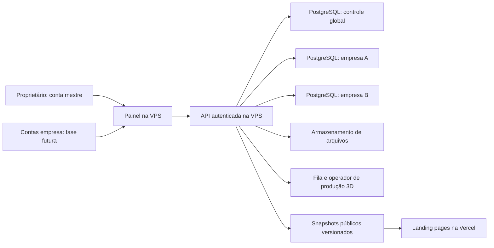

# Planejamento do painel e da plataforma white-label

Status: proposta de arquitetura, sem implementação ou acesso à VPS. Decisões registradas em 10/11/2026. Este documento não altera o escopo da entrega atual do frontend.

## Decisões confirmadas

- Landing pages na Vercel; painel, API e PostgreSQL na VPS do proprietário.
- Conta mestre do proprietário com acesso administrativo global.
- Primeira fase do painel usada somente pelo proprietário. Contas de empresas serão preparadas, mas o acesso dos clientes ficará desabilitado até uma fase posterior.
- Cada empresa terá acesso apenas aos seus dados e operações quando esse acesso for liberado.
- Cadastro de produtos, fotos, preços e dados comerciais no painel.
- Modelos 3D produzidos inicialmente pelo proprietário e pela equipe/agentes, com revisão humana. Estrutura preparada para automatizar etapas no futuro.
- Nesta tarefa: somente planejar o backend. Não criar serviços, bancos, usuários, credenciais, migrações ou deployments.

## Arquitetura recomendada

Um código de API modular e um painel atendem as empresas; um banco PostgreSQL separado por empresa guarda seu catálogo e publicações. Um banco de controle global guarda identidade, vínculo entre usuários e empresas, situação de cada empresa e referências de conexão. Não é necessário duplicar o código ou iniciar um processo de API por empresa para obter esse isolamento de dados.

Se “API de cada empresa” significar também processos separados, essa variante pode ser provisionada pelo mesmo código posteriormente. Ela aumenta o isolamento operacional, mas exige acompanhar mais processos, versões, limites e certificados. A recomendação inicial é API compartilhada com autorização no servidor e credenciais de banco exclusivas por empresa, mantendo a opção de separar processos para clientes específicos.

A landing pública consome somente a publicação aprovada. Ela não recebe acesso ao banco, a rascunhos ou a credenciais administrativas. O painel e a API não precisam ficar disponíveis para cada acesso ao cardápio já publicado.

## Isolamento por banco e plano de controle

| Alternativa | Benefício | Custo ou limite | Direção |
| --- | --- | --- | --- |
| Banco por empresa no mesmo cluster | Backup/exportação e migração por cliente; credenciais separadas | Muitas migrações e pools; recursos físicos compartilhados | Recomendado para a preferência informada |
| Tabelas compartilhadas com tenant_id | Menos bancos e operação inicial simples | Autorização e filtragem precisam estar corretas em toda consulta | Não adotar como padrão desta proposta |
| Instância PostgreSQL por empresa | Maior separação de recursos e falhas | Mais memória, serviços, monitoramento e backups | Evolução para requisitos específicos |

Banco separado não significa VPS separada: indisponibilidade, disco cheio ou comprometimento do host podem atingir todos. O usuário de execução de uma empresa não deve conectar aos bancos das demais, ser superusuário, criar bancos ou executar migrações. PostgreSQL permite controlar privilégios como CONNECT e permissões por objeto; a configuração deve restringir também privilégios concedidos a PUBLIC. [Documentação de privilégios](https://www.postgresql.org/docs/current/ddl-priv.html).

O plano de controle guarda `tenantId`, nome interno do banco, referência do segredo, estado de provisionamento e versão de esquema. O segredo fica fora de respostas HTTP e logs. Não construir nomes de banco com texto fornecido pelo navegador. Resolver a conexão por registro interno autorizado e manter pools limitados, com descarte por inatividade para evitar um pool permanente grande por cliente.

## Identidade e autorização

Entidades globais propostas: `Account`, `Membership`, `TenantRegistry`, `Session`, `AuditEvent` e `ProvisioningOperation`.

- `Account`: identidade autenticada, estado e indicação de superadmin. A promoção a superadmin não é um campo editável pelo próprio usuário.
- `Membership`: relação conta–empresa, papéis e estado; inicialmente todos os acessos de clientes ficam desabilitados.
- `TenantRegistry`: empresa ativa, domínios públicos verificados, referência do banco, versão de esquema e flags de acesso.
- `Session`: sessão revogável, expiração e contexto autenticado; definir provedor de identidade na implementação.
- `AuditEvent`: quem fez o quê, em qual empresa e quando, sem registrar senhas, tokens ou conteúdo sensível desnecessário.

A API autentica a conta, verifica se o acesso ao painel está habilitado, resolve o vínculo e autoriza a operação antes de abrir a conexão do cliente. Um `tenantId` enviado na rota é apenas uma solicitação de contexto; nunca é prova de autorização. A conta mestre pode selecionar uma empresa explicitamente, com indicação visual permanente e auditoria das alterações.

Papéis futuros sugeridos: proprietário da empresa, editor de catálogo e publicador. Permissões para publicar, administrar membros e editar produtos devem ser separadas. Primeiro lançamento: apenas superadmin habilitado; não expor convites ou cadastro público de empresas. Sessões, proteção contra requisições forjadas quando usados cookies, limitação de tentativas e recuperação de conta fazem parte da implementação futura.

Testes obrigatórios de isolamento: usuário A tenta ler/alterar/excluir produto B; troca tenantId na URL; solicita upload para B; acessa job 3D de B; chama publicação e revalidação de B. Todas devem falhar no servidor. Acesso direto ao banco B usando a credencial A também deve falhar.

## Modelo de dados da empresa

Todos os registros possuem identificador estável, datas de criação/alteração e versão para concorrência otimista quando editáveis. IDs do catálogo não devem depender do nome comercial.

| Entidade | Campos e relações principais |
| --- | --- |
| `Restaurant` | Nome, descrição, marca, cores, moeda, idioma, fuso, contatos, domínio canônico, checkout externo, política de publicação |
| `Unit` | Restaurante, endereço, horários estruturados, contatos, situação ativa/em breve |
| `Product` | Nome, descrição, categoria, estado, ingredientes informados, ordem, foto principal e referência opcional de receita 3D |
| `Variant` | Produto, SKU interno, rótulo, disponibilidade, atributos e opção padrão; produto simples recebe uma variante |
| `Price` | Variante ou adicional, valor inteiro em centavos, moeda, unidade comercial opcional, início/fim de vigência e origem; valor exato ou “a partir de” |
| `OptionGroup` / `Option` | Produto, mínimo/máximo de seleções, obrigatoriedade, opções, acréscimo de preço e limite por opção |
| `Combo` / `ComboItem` | Componentes obrigatórios e escolhas permitidas, preço e regras explícitas de substituição; evitar deduzir regras pelo nome |
| `Media` | Chave no storage, MIME detectado, bytes, hash, dimensões, autoria/direitos informados, estado e variantes otimizadas |
| `Model3DAsset` | Produto/receita, versão, GLB e texturas, escala, orientação, medidas, limites técnicos, imagem de fallback e estado de aprovação |
| `Model3DJob` | Produto, revisão das entradas, modo manual/automático, estado, responsável, tentativas, resultados, erro resumido e asset aprovado |
| `MenuPublication` | Versão imutável, versão do esquema público, snapshot, hash, autor, datas, estado, publicação anterior e assets referenciados |
| `OutboxEvent` | Evento transacional pendente para publicação, revalidação ou produção de mídia; tentativas e próxima execução |

Valores exibidos, texto copiado e totais usam as mesmas regras do catálogo publicado. Não modelar pedidos pagos, entregas ou pagamento nesta primeira evolução: o checkout atual continua externo. Sacolas locais guardam IDs e escolhas, não autoridade sobre preços. Ao mudar a publicação, validar produtos e escolhas novamente, apresentar alterações e recalcular antes da revisão final.

## API e contratos

Proposta de contratos, ainda sem endpoints implementados:

- Administração: CRUD de produtos, variantes, preços, grupos, unidades e dados de marca; exclusão lógica quando existir referência em publicação.
- Upload: solicitar autorização de envio, confirmar recebimento e consultar processamento; acesso sempre associado à empresa autorizada.
- Produção 3D: abrir job, anexar resultado, validar, revisar e aprovar uma versão.
- Publicação: validar rascunho, gerar prévia, publicar, consultar andamento e republicar versão anterior como nova publicação.
- Público: consultar versão publicada e snapshot, sem rascunhos ou campos privados.

Usar contratos versionados e validação no servidor, com mensagens de erro por campo. Alterações concorrentes exigem a versão esperada do registro, evitando que uma edição antiga sobrescreva outra. Operações de publicar e concluir jobs aceitam chave de idempotência. Banco e envio de webhook não formam uma única transação distribuída: registrar o evento na outbox junto à mudança e processar depois com repetição segura.

## Arquivos, fotos e modelos

Guardar binários em armazenamento de objetos, não nas tabelas PostgreSQL nem no diretório temporário do processo da API. A localização do storage continua aberta: serviço compatível com S3 externo ou serviço na VPS. Se ficar na VPS, exige backup externo, cotas de disco, monitoramento e teste de restauração. Isso não muda a decisão já confirmada de hospedar painel/API/PostgreSQL na VPS.

Separar originais privados de derivados aprovados públicos. Autorizar uploads por empresa com prazo e limites; validar tamanho real, tipo de arquivo e dimensões após envio. Não confiar somente na extensão. Processar imagens em worker, gerar formatos e tamanhos adequados e remover metadados desnecessários dos derivados públicos.

Chaves de arquivos usam tenant, ID e hash/versão. Não sobrescrever um GLB ou imagem já publicado: uma nova versão recebe outra URL. Fotos, modelos e texturas de uma publicação permanecem disponíveis durante sua retenção para permitir rollback. URLs privadas não entram em snapshots públicos. Exclusão de empresa precisa considerar banco, segredos, mídias, cópias e registros de auditoria conforme política definida.

## Publicação, Vercel e cache

Fluxo recomendado: rascunho → validação → prévia protegida → publicação imutável → ativação → atualização dos destinos públicos.

1. Validar preços, escolhas, URLs, dados comerciais e existência de derivados aprovados. Modelo 3D é opcional; sua ausência mantém o produto no modo simples.
2. Criar `MenuPublication` com snapshot completo e hash. Nenhuma página pública monta um menu combinando preços de uma versão com opções de outra.
3. Registrar evento na outbox. O worker disponibiliza o snapshot e solicita atualização das landings cadastradas.
4. Webhook autenticado usa assinatura, prazo, proteção contra repetição e segredo por destino. Ele invalida apenas restaurante e publicação correspondentes.
5. Exibir no painel a versão aprovada e a versão efetivamente confirmada por cada destino. Falha na revalidação fica pendente para nova tentativa, sem fingir publicação concluída.

A Vercel oferece ISR e revalidação; a invalidação sob demanda é específica do domínio/deployment em que é acionada. Portanto, manter registro explícito de destinos e não presumir que atualizar um projeto atualiza todos. [Documentação de ISR](https://vercel.com/docs/incremental-static-regeneration).

O Next.js documenta que `revalidateTag` com perfil `max` pode servir conteúdo anterior durante a atualização. Definir no contrato o prazo aceitável para propagar preços e usar a versão publicada na interface; não prometer atualização instantânea por chamar uma função. [Documentação de revalidateTag](https://nextjs.org/docs/app/api-reference/functions/revalidateTag).

HTML do cardápio e metadados continuam renderizados no servidor para SEO. Snapshot público e assets têm versão explícita; rotas administrativas e respostas privadas não entram em cache público. Em falha temporária da VPS, a landing conserva a última publicação válida, com política de validade comercial definida. Urgências como indisponibilidade exigem ação separada de suspensão ou atualização com confirmação, não apenas esperar um cache expirar.

Inicialmente manter uma implantação por restaurante, com configuração pequena apontando para sua publicação. Isso reduz mudança no projeto atual. Um frontend compartilhado por domínio pode vir depois, com resolução de host verificado no servidor e chaves de cache isoladas por empresa. Nunca permitir que um cabeçalho arbitrário escolha um catálogo privado.

## Produção 3D manual e evolução automática

Estados do job: solicitado → triagem → em produção → validação técnica → revisão visual → aprovado, rejeitado ou falhou. Cancelamento é explícito. O produto continua disponível em fotos enquanto o job não termina.

Entradas incluem fotos de referência, medidas, ingredientes, revisão do produto e instruções de aparência. A primeira execução é manual pelo proprietário/equipe, sem chamada automática paga. Entregáveis incluem GLB, dependências, fallback, miniatura e relatório de tamanho, materiais, texturas, escala e compatibilidade.

O job guarda `producer` e `producerVersion`, entradas por hash e resultados versionados. Assim, um executor automático futuro pode produzir o mesmo contrato sem mudar o cadastro do produto. Ele roda fora da requisição HTTP, com limites de execução/custo, tentativas controladas e chave idempotente. Repetição não deve publicar duplicatas nem cobrar etapas caras indefinidamente.

Automação futura não elimina revisão: aprovação humana continua necessária antes da primeira publicação de um asset. Avaliar visualmente contra referências e tecnicamente em dispositivo limitado. Declarar capacidades por produto: visualização estática, montagem em camadas e AR são capacidades diferentes; um GLB genérico não oferece automaticamente montagem interativa.

## Operação e custos

Sem valores estimados até conhecer volume e configuração da VPS. Medir: empresas ativas, quantidade de produtos, fotos/GLBs por produto, armazenamento de originais e derivados, tráfego de assets, retenção, frequência de publicações, simultaneidade do painel e horas de produção 3D.

Componentes de custo: VPS, armazenamento/backup externo, tráfego, domínio, Vercel e funções/revalidação, observabilidade, envio de autenticação se adotado, operação humana e eventual produção automática. Não assumir que planos gratuitos cobrem uso comercial ou volume futuro; conferir planos no momento da contratação.

Operação mínima planejada: TLS, atualização do host, backups criptografados fora da VPS, alerta de disco/conexões/erros, rotação de segredos, trilha de auditoria e restauração ensaiada. PostgreSQL `pg_dump` exporta um banco, mas objetos globais como roles exigem tratamento separado; não confundir exportação lógica com estratégia completa de recuperação. Definir backup físico/PITR conforme metas de perda e recuperação. [Documentação de pg_dump](https://www.postgresql.org/docs/current/app-pgdump.html).

Migrações precisam de inventário por empresa, execução piloto, compatibilidade entre versões durante a atualização e registro de falhas. Um cliente que falhe não deve bloquear todos. Aplicar limites por empresa e reservar recursos para evitar que um upload ou job 3D esgote a VPS do banco.

## Fases de migração e critérios de saída

| Fase | Entrega futura | Critério de saída |
| --- | --- | --- |
| 0 — frontend atual | Configuração por implantação, catálogo único, sacola e capacidade 3D explícita | Funciona sem API; sem regressão de preço/edição |
| 1 — contrato | Esquema público versionado e adaptador que lê configuração local ou snapshot | Mesma tela e mesmos totais para ambas as fontes |
| 2 — base privada | Painel/API na VPS, controle global e banco piloto; apenas superadmin | Isolamento, backup/restauração e sessão testados; cliente continua sem acesso |
| 3 — catálogo e publicação | CRUD, fotos, prévia, snapshot e sincronização Vercel | Alteração aprovada aparece no destino correto; falha e rollback ensaiados |
| 4 — produção 3D manual | Jobs, anexos, validação e aprovação humana | Produto sem 3D vende normalmente; asset aprovado entra sem alterar frontend |
| 5 — acesso de clientes | Contas/vínculos/papéis e liberação por empresa | Testes negativos entre empresas e auditoria aprovados antes de habilitar |
| 6 — automação gradual | Executores de mídia/3D atrás do contrato de jobs | Qualidade, custo máximo e recuperação demonstrados; revisão preservada |

A migração inicial importa a configuração existente como primeira publicação. IDs de produtos são preservados ou recebem mapa explícito de migração de sacola. Manter o adaptador local até validar leitura, publicação e recuperação no piloto; remover apenas quando o fallback operacional estiver comprovado.

## Questões abertas para detalhar depois

- Capacidade atual da VPS, banco já instalado, região, serviços concorrentes e rotina existente de backup.
- Quantas empresas/produtos inicialmente e ritmo esperado de entrada.
- Uma empresa pode ter várias marcas e cardápios por unidade, ou inicialmente um restaurante com várias unidades.
- Storage externo ou na VPS; volume de assets e retenção de originais/publicações.
- Metas de recuperação e perda tolerada, prazo aceitável para propagar preço e tratamento de indisponibilidade urgente.
- Domínios próprios por cliente, estratégia de previews e endereço definitivo da Alhoaria.
- Provedor de identidade, recuperação da conta mestre e uso de autenticação multifator.
- Quem pode publicar quando o cliente for liberado e se a aprovação do proprietário continuará obrigatória.
- Regras comerciais reais de variantes, combos, disponibilidade e preços por unidade.

Essas questões não impedem concluir as melhorias autorizadas do frontend. São entradas para uma futura especificação executável do painel e infraestrutura.
